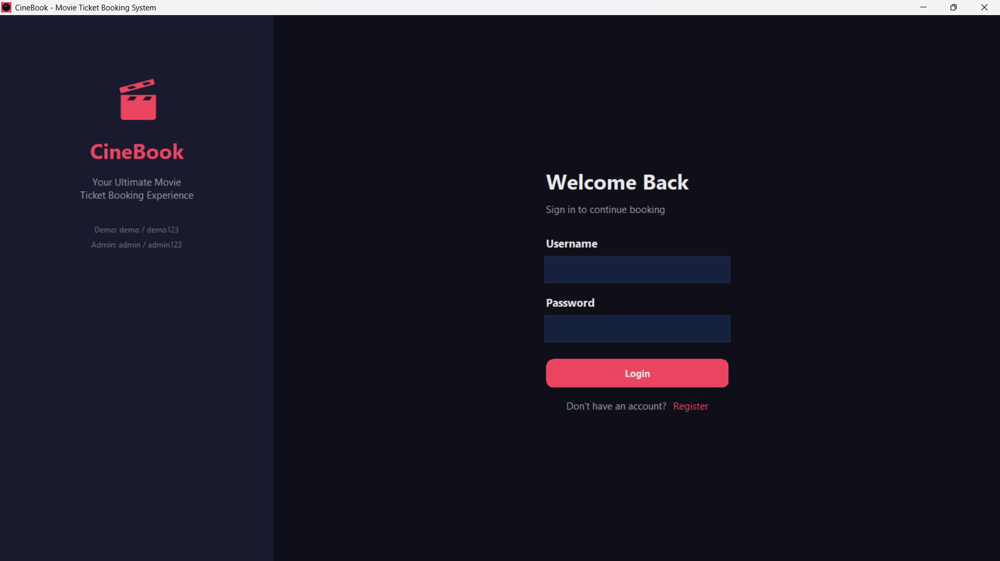
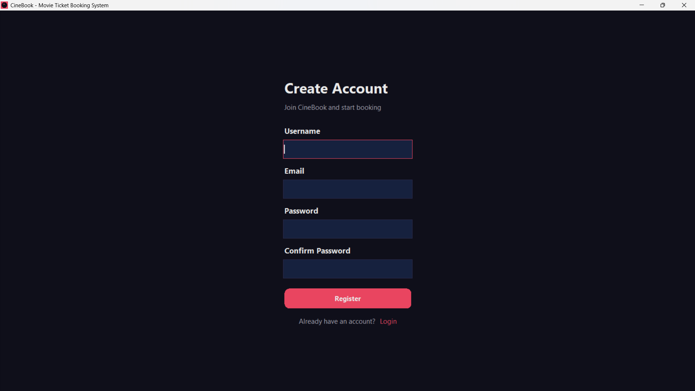
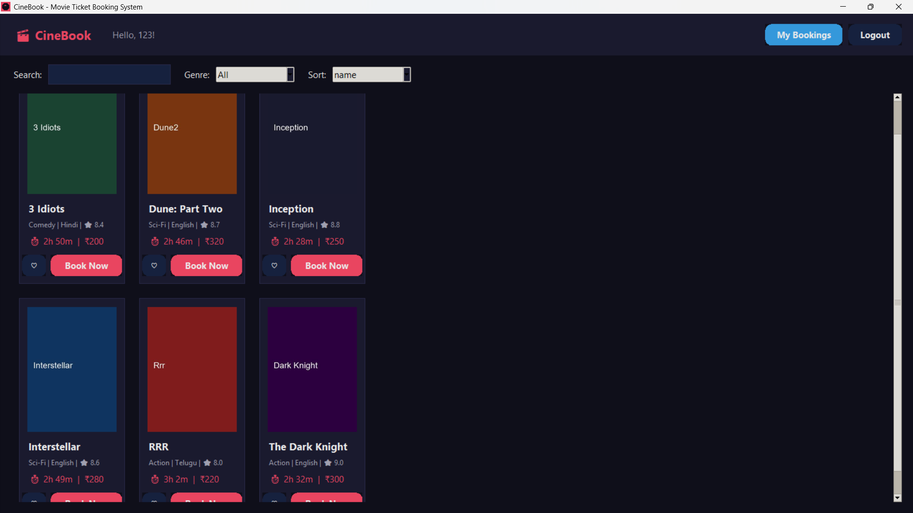
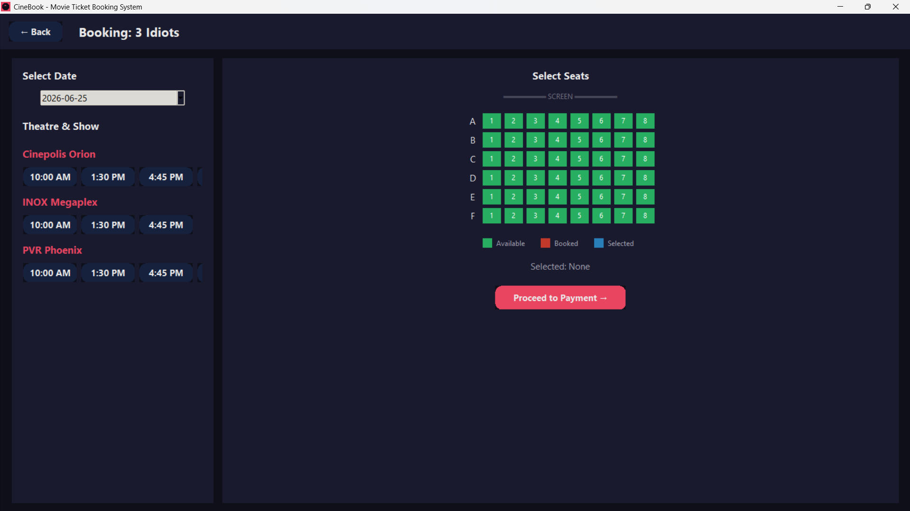
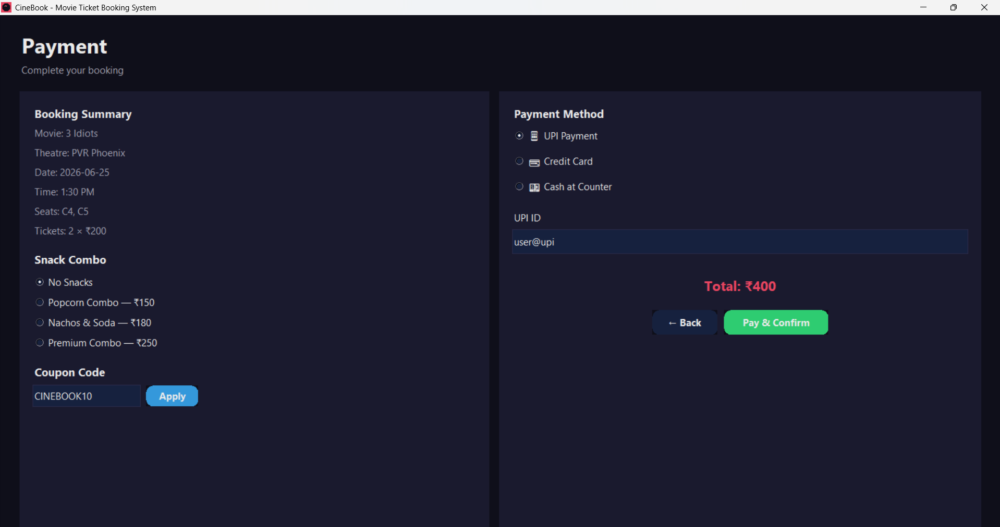
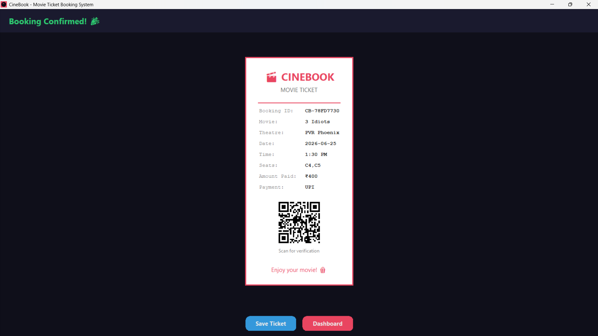

<div align="center">

# 🎬 CineBook - Movie Ticket Booking System

A modern **Movie Ticket Booking System** built with **Python, Tkinter, and SQLite**. This desktop application allows users to browse movies, select seats, book tickets, and manage bookings through an attractive and user-friendly interface.




</div>

---

## ✨ Features

- 👤 User Registration & Login
- 🎬 Browse Available Movies with Posters
- 🔍 Search & Filter Movies by Genre
- 🏢 Multiple Theatre Selection
- 🕒 Choose Show Timings & Dates
- 💺 Interactive 6×8 Seat Layout
- 🍿 Snack Combo Add-ons
- 💳 Payment Simulation (UPI, Credit Card, Cash)
- 🎟 QR Code Ticket Generation
- 📜 Booking History with Cancel Option
- 🏷 Discount Coupon Support
- 📊 Admin Dashboard with Analytics
- 💾 SQLite Database Integration
- 🎨 Modern Dark-Themed Tkinter GUI

---

## 🛠 Tech Stack

| Technology | Purpose |
|---|---|
| Python 3 | Core language |
| Tkinter | Desktop GUI framework |
| SQLite3 | Local database |
| Pillow | Image handling & movie posters |
| qrcode | QR code generation on tickets |
| OOP | Modular class-based design |

---

## 📂 Project Structure

```
CineBook/
│
├── main.py              # Application entry point
├── database.py          # SQLite schema & data operations
├── login.py             # Login screen
├── register.py          # User registration
├── dashboard.py         # Movie browsing dashboard
├── booking.py           # Theatre & seat selection
├── payment.py           # Payment simulation
├── admin.py             # Admin management panel
├── ticket.py            # Ticket & booking history
├── ui.py                # Shared theme & UI components
├── generate_assets.py   # Poster/logo generator script
│
├── database/
│      cinebook.db       # Auto-created SQLite database
│
├── assets/
│      posters/          # Movie poster images
│      logo.png          # App logo
│
├── Screenshots/         # Application screenshots
│
├── requirements.txt
└── README.md
```

---

## 📸 Screenshots

### 🔐 Login Page
User authentication with secure password hashing (SHA-256). Register a new account or use demo credentials to get started.


### 🎬 Movie Dashboard
Browse movies with posters, ratings, genre, language, duration, and price. Search, filter by genre, and sort by rating or price.



### 🏢 Theatre & Show Selection
Select your preferred theatre, show date, and show timing for the movie you want to watch.



### 💺 Seat Selection
Interactive 6×8 seat grid — Green seats are available, Red are booked, and Blue are your selected seats. Book up to 10 seats at once!



### 💳 Payment Page
Complete your booking with UPI, Credit Card, or Cash. Add snack combos and apply discount coupons (`CINEBOOK10`, `MOVIE20`, `WEEKEND15`).



### 🎟 Ticket & Booking History
View your generated ticket with QR code, or access your booking history to view past bookings, cancel tickets, or reprint.



---

## ▶ Installation

### Prerequisites
- Python 3.10 or higher
- pip

### Setup

```bash
# Clone the repository
git clone https://github.com/mansii1007/CineBook.git
cd CineBook

# Install dependencies
pip install -r requirements.txt

# Generate poster assets (optional — placeholders are auto-created at runtime)
python generate_assets.py

# Run the application
python main.py
```

---

## 🔑 Default Login Credentials

| Role | Username | Password |
|---|---|---|
| Demo User | `demo` | `demo123` |
| Admin | `admin` | `admin123` |

---

## 🎯 Application Modules

### 👤 User Module
- Register User
- Login User
- Logout
- Profile Management

### 🎬 Movie Module
- Display Movies with Posters
- Search Movies by Name
- Filter by Genre
- Sort by Rating or Price
- Movie Details (Genre, Language, Duration, Rating)
- Favorite Movies

### 🏢 Theatre Module
- Select Theatre
- Choose Show Date
- Show Timings
- Screen Details

### 💺 Seat Booking Module
- 6×8 Interactive Seat Grid
- Color-Coded Status (Available / Booked / Selected)
- Multi-Seat Booking (up to 10)
- Prevent Double Booking

### 💳 Payment Module
- UPI
- Credit Card
- Cash
- Snack Combos
- Discount Coupons

### 🎟 Ticket Module
Generates ticket containing:
- Booking ID
- Movie Name
- Theatre & Screen
- Show Time & Date
- Seat Numbers
- Payment Method
- Snacks Ordered
- Discount Applied
- Total Amount
- QR Code for Verification
- Save to File

### 📜 Booking History
- View Previous Bookings
- Cancel Booking
- Re-Print Ticket

### 👨‍💼 Admin Module
- Add / Edit / Delete Movies
- Add Show Timings
- View All Bookings
- Revenue Analytics
- Seat Occupancy Reports

---

## 🗄 Database Schema

| Table | Key Fields |
|---|---|
| **Users** | id, username, email, password, is_admin |
| **Movies** | id, movie_name, genre, duration, language, rating, price, poster |
| **Shows** | id, movie_id, theatre, timing, show_date |
| **Bookings** | booking_id, user_id, movie_id, show_id, seats, amount, payment_method |
| **Favorites** | user_id, movie_id |
| **Coupons** | code, discount_percent |
| **Snacks** | id, name, price |

---

## 🚀 Future Enhancements

- 📧 Email Ticket Confirmation
- 🌐 Online Payment Gateway Integration
- 🎬 Movie Poster API (TMDB)
- ⏱ Real-Time Seat Availability
- 🍿 Extended Snack Menu
- 🎁 More Discount Coupons & Offers
- 🌙 Dark & Light Theme Toggle
- 🌐 Multi-language Support
- 📈 Advanced Analytics Dashboard
- 📱 Mobile Companion App

---

## 📚 Concepts Used

- Object-Oriented Programming (OOP)
- Functions & Modules
- SQLite Database & CRUD Operations
- Exception Handling
- File Handling
- GUI Development with Tkinter
- Database Connectivity
- Input Validation
- Secure Password Hashing

---

## 👨‍💻 Author

**Mansi Patil**

Computer Engineering Student


---

## ⭐ Support

If you like this project, don't forget to ⭐ star the repository!

---

## 📄 License

This project is open source and available for educational and portfolio use.
